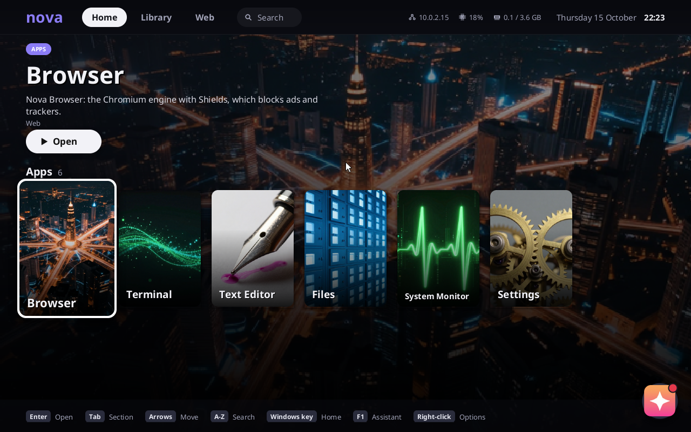
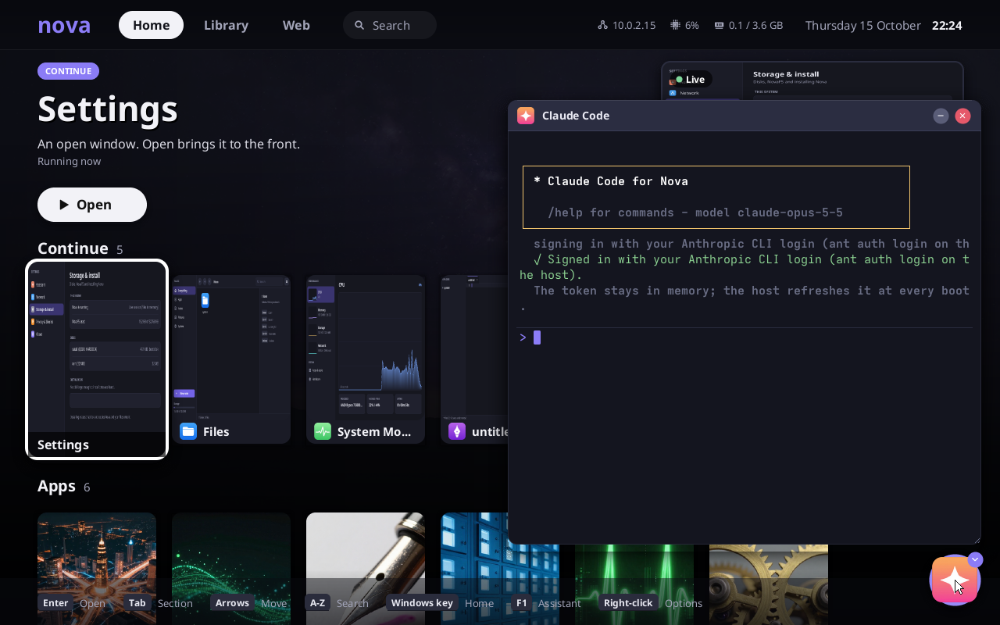
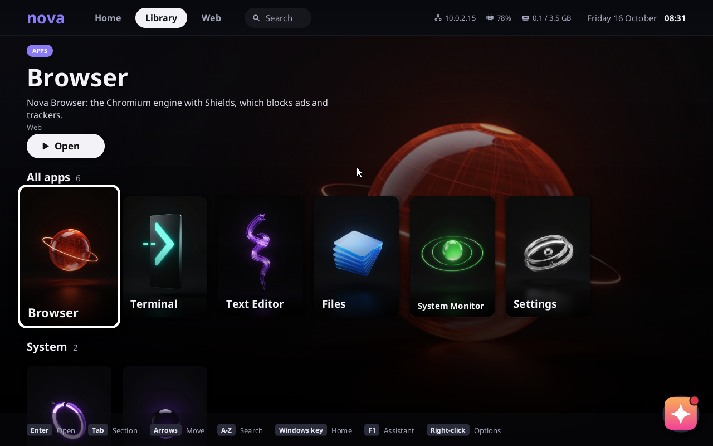
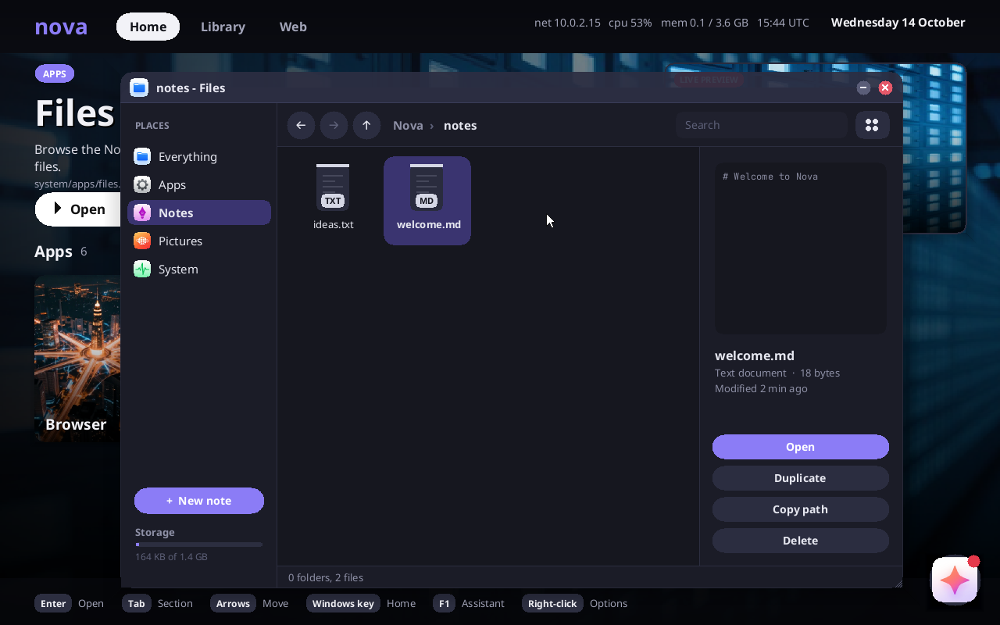
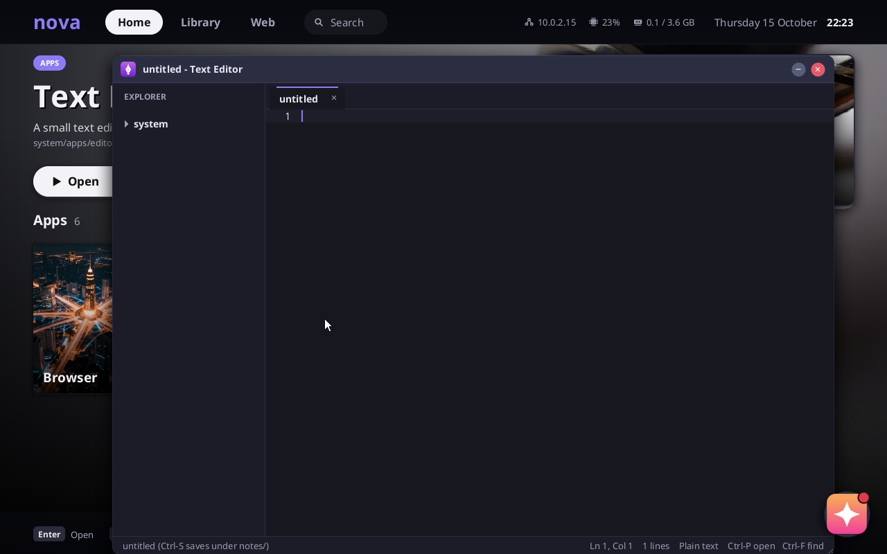
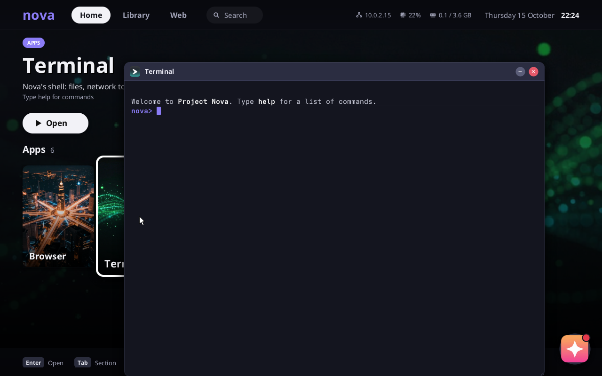
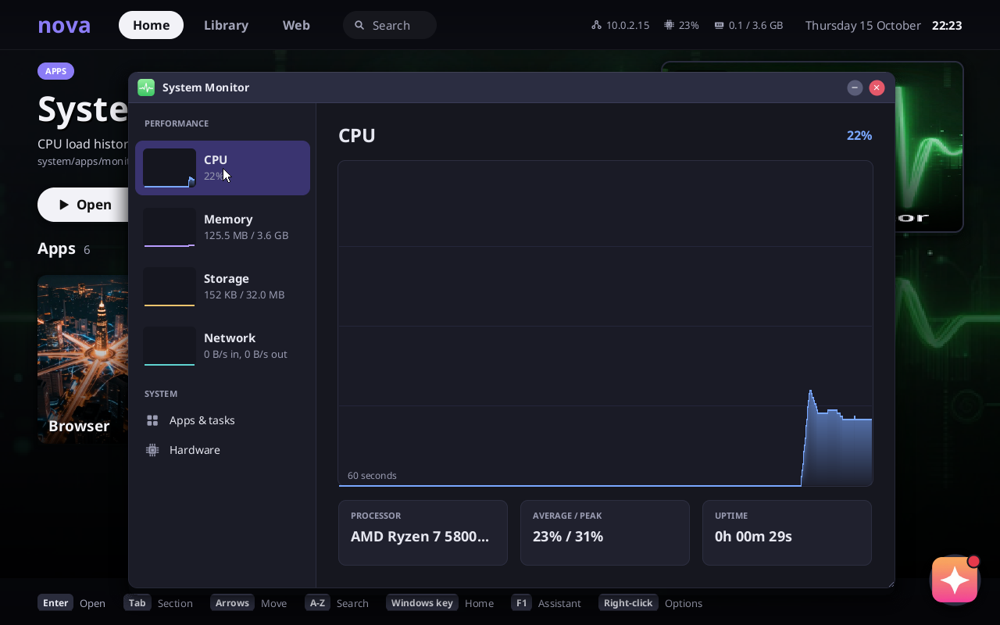
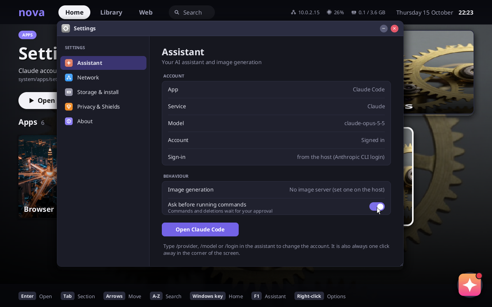
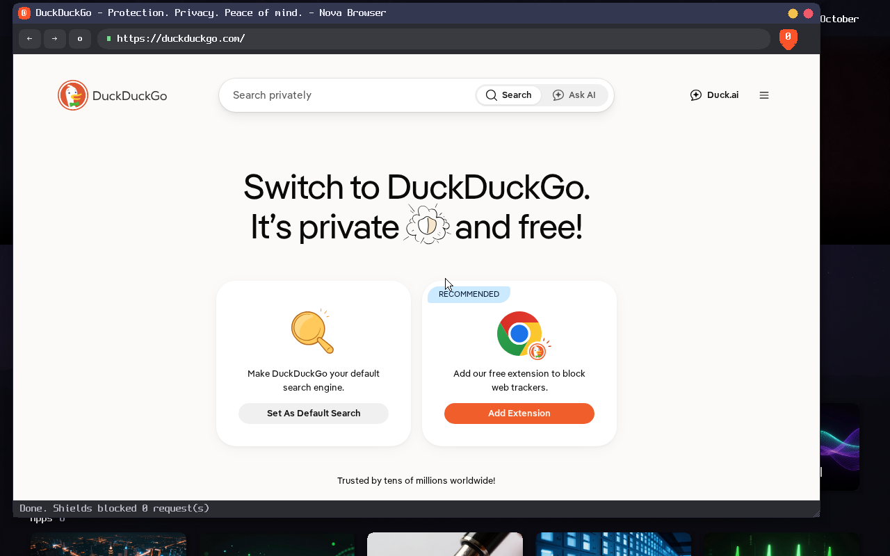

# Project Nova

A small x86-64 operating system written in Rust, with an AI coding agent built in. Nova boots
from an installation image into a terminal where Nova Assistant runs (on DeepSeek by default, or
as Claude Code on Anthropic's API). You sign in, Nova detects the hardware and installs its Rust
drivers (the assistant drafts ports for anything without a driver), offers to install itself to a
disk, and then drops you into a desktop. On the desktop, the assistant is the app creator: ask
for an app and it writes, checks and opens it.





| | |
|---|---|
|  |  |
|  |  |
|  |  |



## What works

| Area | What Nova does |
|---|---|
| Boot | UEFI (OVMF) → Limine → Nova kernel; GDT/IDT, exception reports, panic handler |
| CPU | interrupts (local APIC + I/O APIC from ACPI, MSI/MSI-X; 8259 PIC fallback), ACPI through uACPI, 100 Hz timer, cooperative kernel tasks, preemptive user programs, CPU load |
| Memory | 1 GiB VM, heap (talc), MMIO mappings, per-process address spaces with demand paging |
| Drivers | NVMe SSDs, Intel e1000 Ethernet, AHCI SATA, PS/2 keyboard and mouse (absolute pointer via vmmouse), serial, framebuffer, RTC; optionally unmodified Linux drivers on a Linux-API layer (RealTek 8139/8139C+, Intel 82574 `e1000e`, and the USB stack: xHCI, hubs, HID keyboards and mice; see [docs/linux-drivers.md](docs/linux-drivers.md)) |
| Internet | DHCP, DNS, TCP (smoltcp); HTTPS with certificate verification (rustls + RustCrypto + Mozilla roots) |
| Storage | NVMe (install and boot), AHCI SATA, GPT, NovaFS (Nova's filesystem), installer that copies Nova onto a second disk |
| Desktop | Nova Home, in the style of TV/console launchers: Home, Library and Web tabs, shelves of portrait covers (open windows as live thumbnails, your apps, apps, sites, system), the focused item's artwork as a full-screen backdrop, live app previews, keyboard hints; no taskbar: the Windows key brings back Home, right-click a running window's cover to stop it. The assistant is a chat bubble in the bottom-right corner (click it or press F1) |
| Core apps | Native Rust apps in Nova's style: **Terminal** (smooth monospace font, 2,000 lines of scrollback on the wheel, command blocks, block cursor), **Text Editor** (file explorer, tabs, syntax colours, mouse selection, clipboard, undo/redo, Ctrl-F find, Ctrl-P quick open), **Files** (places, breadcrumbs, search, grid with thumbnails or list, preview pane, open/duplicate/copy path/delete), **System Monitor** (live CPU/memory/storage/network graphs, apps and tasks with End, hardware and drivers), **Settings** (assistant, network, storage and install, privacy and Shields, about) |
| Assistant | Nova Assistant on DeepSeek (or Claude Code on Anthropic); sign-in from the host's key or Anthropic CLI login, streaming agent loop with tools (files, shell, HTTP, hardware, web search), app creation with screenshot checks |
| Apps | Rhai scripts with a drawing API (including PNG images); the assistant designs them with a generated mockup, builds them with generated artwork, and they appear on Home |
| Linux programs | x86-64 Linux binaries run unmodified in user mode: C/C++ (glibc, libstdc++), static or dynamically linked, multi-threaded, with sockets, pipes, epoll and shared memory; processes (fork, vfork, posix_spawn, execve with `#!` scripts, wait) and signals (handlers, masks, kill, SIGCHLD); with BusyBox, a Unix shell and ~400 tools (`sh`, then pipelines, loops, `tar`, `awk`, ...). 32-bit (i386) Linux programs run too, in compatibility mode (`int 0x80`, TLS descriptors, `ld-linux.so.2`), as Steam's bootstrap needs |
| Browser | Nova Browser: the Chromium engine (rendering, JavaScript, TLS) driven by a Rust shell with Shields (ad/tracker blocking, HTTPS upgrades, tracking-parameter removal) |

## Quick start

```sh
scripts/check-prereqs.sh   # see docs/setup.md
scripts/fetch-chromium.sh  # optional: the browser engine (about 100 MB download)
scripts/fetch-filters.sh   # optional: EasyList + EasyPrivacy for Shields (recommended)
scripts/fetch-linux.sh     # optional: Linux source for FEATURES=linux-drivers (docs/linux-drivers.md)
scripts/fetch-busybox.sh   # optional: BusyBox, a Unix userland (sh, coreutils, tar, ...) in bin/
scripts/build.sh           # kernel, user programs, build/nova.img
scripts/run.sh             # boot like a real machine: installer image + empty 2 GiB disk
```

First boot:

1. Nova lists the hardware and the driver it installed for each device.
2. The assistant signs in. `run.sh` passes your key into the VM, so there is nothing to type:
   put a DeepSeek API key (https://platform.deepseek.com/api_keys) in `DEEPSEEK_API_KEY` or in
   the file `~/.config/nova/deepseek-api-key` (outside the repository, `chmod 600`). For Claude
   instead, log in on the host with the Anthropic CLI (`ant auth login`) and run with
   `NOVA_AI=anthropic`. Without either, Nova asks for a key; press Enter to skip.
3. Signed in, the assistant ports drivers for devices Nova does not support yet (saved under `drivers/`
   for the next kernel build).
4. Nova offers to install itself on the 2 GiB disk (`build/disk.img`). After installing it
   restarts, and `scripts/run.sh` boots the installed disk from then on.
5. Nova Home opens, with the assistant in a window. The Windows key (or a window's yellow
   minimize button) brings you back to Home, where open windows wait in the Continue row.
   Ask the assistant for an app, for example "make me a pomodoro timer".

The serial console is in the terminal that runs `run.sh`; the Claude Code window mirrors it, so
you can also type there (and paste your API key). Quit QEMU with `Ctrl-A` then `X`.

Options: `scripts/run.sh --fresh` (erase the disk and start over), `--live` (always boot the
installer image), `--headless` (no window), `--no-host-login` (don't pass your login in).

### Shell and programs

The Terminal app runs Nova's shell (`help` lists commands: `ls`, `cat`, `lspci`, `ifconfig`,
`fetch https://...`, `disks`, `install`, ...). Programs in `bin/` run like commands:

```
nova> hello world
Hello from C on Nova!
nova> cxxtest
cxxtest: C++ runtime checks
  ok   exception thrown through 50 frames
  ...
cxxtest: 17 passed, 0 failed
```

Add your own: put a `.c` or `.cpp` file in `userland/` (static) or `userland/dynamic/`
(dynamically linked; its shared libraries are bundled automatically), run `scripts/build.sh`,
and it shows up as `bin/<name>`. `strace <program>` logs a program's system calls to the serial
console.

### Browser

With the engine downloaded (`scripts/fetch-chromium.sh`), the desktop has a **Browser** icon
(and the shell a `browser [url]` command). Type a URL or a search in the address bar; click,
scroll and type in pages. The orange shield shows how many ads and trackers Shields blocked on
the page; click it for the list and to turn Shields down for a site. With the bundled
EasyList and EasyPrivacy (`scripts/fetch-filters.sh`; both GPLv3 / CC BY-SA, downloaded at
build time and not kept in this repository), Shields scores 97/100 on adblock-tester.com. Add EasyList with
`download https://easylist.to/easylist/easylist.txt system/shields/easylist.txt` in the Terminal.
The engine is Chrome for Testing's headless shell; Nova's browser UI and Shields are written in
Rust (see [docs/architecture.md](docs/architecture.md#nova-browser-and-shields-04)).

## Commands

| Task | Command |
|---|---|
| Check prerequisites | `scripts/check-prereqs.sh` |
| Build kernel + programs + image | `scripts/build.sh` |
| Boot (installer + disk, then installed system) | `scripts/run.sh` |
| **All tests** | `scripts/test.sh --all` |
| One test case / list cases | `scripts/test.sh --case native` / `scripts/test.sh --list` |
| Download the browser engine | `scripts/fetch-chromium.sh` |
| Clean generated artifacts | `scripts/clean.sh` |

`scripts/test.sh --all` boots QEMU headless for each of 21 cases and checks the serial output:
boot, panic and 7 CPU-exception cases; shell and PS/2 keyboard input; native C/C++ programs
(static, dynamic, threaded); Linux sockets (`net`); the Chromium engine rendering a page
(`chromium`); Nova Browser opened by Claude with Shields blocking a tracker (`browser`; both
skipped without the engine); and the full first-boot flow (`setup`: login, driver porting, installation) followed by the installed
system building an app with Claude (`installed`), first boot signed in with a host login
token (`hostlogin`), the same flow on DeepSeek, including image
generation against a ComfyUI stand-in (`deepseek`), and a program using up all memory being
stopped while the system keeps running (`oom`). The Claude cases use `scripts/mock_anthropic.py`,
a local stand-in for the Messages API that also checks Nova's requests follow the API rules.
Logs go to `build/logs/test-<timestamp>/`.

Environment overrides: `LIMINE_EFI`, `OVMF_CODE`, `OVMF_VARS_TEMPLATE` (file locations),
`NOVA_NO_KVM=1` (software emulation), `PROFILE=dev` (debug build), `TIMEOUT`, `NOVA_CMDLINE`
(kernel command line baked into `build/nova.img`), `CC`/`CXX` (compilers for `userland/`).

Kernel command line options: `nova.mode=shell` (text shell instead of setup/desktop),
`nova.install=no` (don't offer installation), `nova.deepseek_api=<url>` (DeepSeek-mode endpoint), `nova.comfyui=<url>` (image server), `nova.claude_api=<url>` (another API endpoint),
`nova.test=<case>` (self-tests).

## Repository layout

| Path | Purpose |
|---|---|
| `kernel/` | the kernel crate (see [docs/architecture.md](docs/architecture.md) for every module) |
| `kernel/src/apps/` | bundled desktop apps (Rhai) |
| `kernel/src/claude_prompt.md` | system prompt of Claude Code for Nova |
| `userland/` | C and C++ programs shipped in `bin/` (`dynamic/`: dynamically linked) |
| `boot/limine.conf` | Limine configuration |
| `scripts/` | build, image, run and test scripts; `fetch-chromium.sh`; `mkpak.py` (system-file pack); the mock Claude API and a QMP input helper |
| `docs/` | [setup.md](docs/setup.md) (prerequisites), [architecture.md](docs/architecture.md) |
| `build/` | generated: images, disks, logs (git-ignored) |

## Generated artwork

With a ComfyUI server configured, the assistant designs every app with an image model first.
It generates a small mockup of the app window (layout, buttons, colours) and builds the app to
match it. It generates the illustrations and sprites the app draws with `g.image`. Then it
compares `check_app` screenshots against the mockup. Put the server's address in
`NOVA_COMFYUI_URL` or `~/.config/nova/comfyui-url` (outside the repository); `run.sh` passes it
in. The workflow is Z-Image Turbo (8 steps); the server needs `z_image_turbo_bf16.safetensors`,
`qwen_3_4b.safetensors` and `ae.safetensors`. Without a server, apps are built from drawing
calls only. Home's posters and wallpaper, the app icons and the browser's toolbar glyphs (`assets/`, see
[assets/README.md](assets/README.md)) were made the same way.

## About the assistant

The assistant calls the Messages API directly from the kernel over HTTPS, against one of two
providers (`/provider` switches):

- **DeepSeek** (default): Nova Assistant, model `deepseek-flash` (it reads the app screenshots;
  `deepseek-v4-pro` is text only), through DeepSeek's Anthropic-compatible endpoint
  `https://api.deepseek.com/anthropic`. Screenshots go beside tool results, where DeepSeek reads
  them.
- **Anthropic**: Claude Code for Nova, `claude-opus-5-5` with adaptive thinking and server-side
  refusal fallbacks.

Signing in: at every boot `scripts/run.sh` looks for `DEEPSEEK_API_KEY` or
`~/.config/nova/deepseek-api-key`, then (or first, with `NOVA_AI=anthropic`) runs
`ant auth print-credentials --access-token` on the host (falling back to `ANTHROPIC_AUTH_TOKEN`,
then `ANTHROPIC_API_KEY`) and hands the result
to the VM through QEMU's fw_cfg, from a temporary mode-600 file under `build/` that is deleted
when QEMU exits. Nova sends it as `Authorization: Bearer` with the `oauth-2025-04-20` beta and
keeps it only in memory. The token is short-lived: if a session outlives it, restart Nova to get a
new one. An API key entered with `/login` instead is stored on the Nova disk in `system/claude.json`. Requests cost
API credits like any other use of the API. Without a key, everything except the assistant works.

## Tested versions

Verified on 2026-10-14 on CachyOS (Linux 7.2.9, x86_64, KVM):

| Tool | Version |
|---|---|
| Rust | 1.99.0 (pinned in `kernel/rust-toolchain.toml`), target `x86_64-unknown-none` |
| QEMU | 11.1.2, machine `q35,vmport=on`, OVMF edk2 202608 |
| Limine | 12.9.0 |
| GCC | 16.2.1 (glibc and libstdc++ for `userland/`) |
| Chromium | 155.0.8059.79 (Chrome for Testing headless shell) |

Kernel crate dependencies: talc, spin, smoltcp, rustls, rustls-rustcrypto, webpki-roots, getrandom
(custom backend), sha2, serde_json, rhai, miniz_oxide.

Bundled from the build machine (not in the repository): the shared libraries dynamically linked
programs need (glibc, libstdc++, ...), and with the browser: Chrome for Testing's
`chrome-headless-shell` (Chromium, BSD-style license plus third-party notices in its
`LICENSE.headless_shell`), the libraries it links (glib, NSS, X11 client libraries, ...), and the
Liberation and Noto fonts (SIL Open Font License). The console font is Spleen 8x16 by Frederic Cambus
(BSD-2-Clause, `kernel/src/font/LICENSE.spleen`).
