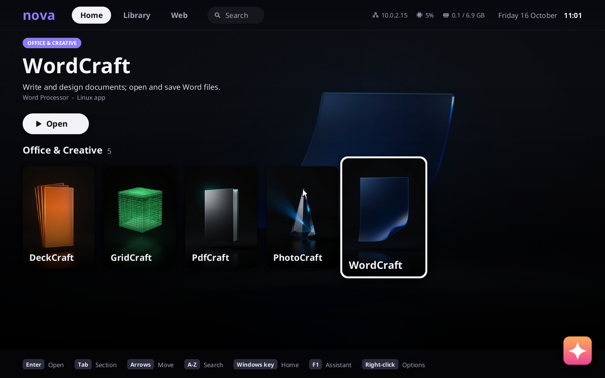

# The Craft App Suite on Nova

Nova has no office suite, PDF reader or image editor of its own. The
[Craft App Suite](https://github.com/storytold) fills that gap: pure-Rust desktop apps
(egui/eframe with wgpu, winit), MIT OR Apache-2.0, published as Linux x86_64 release
builds. Nova runs those release binaries unmodified, on its own Wayland compositor, with
Mesa's software renderer. Nothing of them is in this repository: the image build downloads
them.



| App | Does | On Nova |
|---|---|---|
| WordCraft | word processor (.docx, .odt, .rtf, .md) | opens a .docx, typing and Ctrl+S save it ([screenshot](screenshots/craft-wordcraft.png)) |
| GridCraft | spreadsheets (.xlsx, .ods, .csv) | opens an .xlsx, formulas computed ([screenshot](screenshots/craft-gridcraft.png)) |
| DeckCraft | presentations (.pptx) | opens a .pptx, slides and thumbnails ([screenshot](screenshots/craft-deckcraft.png)) |
| PdfCraft | PDF reader and editor | opens a PDF ([screenshot](screenshots/craft-pdfcraft.png)) |
| PhotoCraft | photo editor (.png, .jpg, .psd, ...) | opens a PNG; its GPU compositor gives up on llvmpipe and it switches to CPU rendering, with a dialog ([screenshot](screenshots/craft-photocraft.png)) |
| LightCraft, FilmCraft, SoundCraft, VectorCraft, DesignCraft, FigCraft, CadCraft, EffectCraft, ArtCraft launcher | photos, video, audio, vector, design, CAD, effects | opt-in (`NOVA_CRAFT=all` or by name), not tested yet |

The default set is WordCraft, GridCraft, DeckCraft, PdfCraft and PhotoCraft.

## Building an image with them

```sh
NOVA_CRAFT=1 scripts/build.sh                          # the default set
NOVA_CRAFT=wordcraft,pdfcraft scripts/build.sh         # a list
NOVA_CRAFT=all scripts/build.sh                        # all fourteen
IMAGE=build/craft.img NOVA_CRAFT=1 scripts/build.sh && IMAGE=build/craft.img NOVA_RAM=6G scripts/run.sh
```

`scripts/fetch-craft.sh` (run by the build) asks the GitHub API for each app's latest
release, downloads its `<app>-<version>-linux-x86_64.tar.gz` into
`$NOVA_CRAFT_CACHE` (default `/tmp/nova-craft-cache`, outside the repository and build/),
checks its SHA-256 against the release's `SHA256SUMS.txt` (or GitHub's digest of the
asset) and unpacks it there. Without a network connection the cached version is used.

What the image gets (scripts/build.sh, the `NOVA_CRAFT` block):

- `/opt/<app>/bin/<app>` and `/opt/<app>/share/` (icons, licences, PdfCraft's OCR models).
  The `-cli` tools are left out. The binaries are linked from the cache into the sysroot,
  so build/ holds them only inside the pak.
- `/usr/bin/<app>`, a launcher script: `WAYLAND_DISPLAY`, `EGL_PLATFORM=wayland`,
  `LIBGL_ALWAYS_SOFTWARE=1`, `GALLIUM_DRIVER=llvmpipe`, `WGPU_BACKEND=gl` (no Vulkan
  driver in a VM; wgpu's OpenGL backend on Mesa), `PDFCRAFT_RENDERER=gl`,
  `PHOTOCRAFT_NATIVE_WAYLAND=1`, and `HOME=/home/nova` (tmpfs: settings, logs, caches;
  NovaFS keeps a 1024-file limit) when `HOME` is `/`.
- `/usr/share/applications/<id>.desktop`, the app's own desktop entry with `Exec` pointing
  at the launcher plus `X-Nova-Icon` and `X-Nova-Poster` for Nova's icon and Home art.
- The libraries the apps load with `dlopen` (`ldd` shows only libc, libm and libgcc_s):
  libwayland-client/-cursor/-egl, libxkbcommon(-x11) and its Compose tables, libEGL/libGL
  with Mesa (llvmpipe; shared with `NOVA_STEAM`), libX11/xcb/Xcursor/Xi/Xrandr (for X11),
  libdbus-1 (file-dialog portal), fontconfig and fonts.
- Sample documents (`scripts/make-craft-samples.py`, standard library only, so nothing
  copyrighted ships): `/usr/share/nova/craft/samples/sample.{docx,xlsx,pptx,pdf,png}`.

Sizes with the default set (Mesa 26.2, Chromium in the image too): the apps are 409 MB
(WordCraft 100, GridCraft 34, DeckCraft 85, PdfCraft 87, PhotoCraft 91; their fonts are
built in), the system pak 1051 MiB (about 400 MiB without NOVA_CRAFT; Mesa with LLVM is
280 MB of the difference), the disk image 1219 MiB. Limine loads the pak into memory, so
give the VM 4 GiB or more (tested with 8 GiB, 4 CPUs, KVM).

## Using them

Home shows an **Office & Creative** row (and a Library section) with one card per app
found in `/usr/share/applications`; there is no entry for an app that is not in the image.
Open starts the app. **Files** opens `.docx .xlsx .pptx .pdf .png ...` with the app whose
desktop entry claims the type (`MimeType`), and names it ("PdfCraft document"); text files
stay with Nova's Text Editor. The shell's `open <file>` does the same. Documents opened
from NovaFS (for example `Documents/sample.docx`) are saved back there; the apps see
NovaFS at `/`.

The file dialogs (Open, Save As) would use the xdg-desktop-portal over D-Bus; Nova has no
session bus, so the apps fall back to their built-in file browsers, which work.

## What Nova needed

| The apps needed | Nova provides |
|---|---|
| A desktop entry registry: icon, name, MIME types | `kernel/src/desktop.rs` reads `usr/share/applications/*.desktop`; Home, Files, the shell's `open` and the compositor use it |
| No second title bar (winit draws its own frame without xdg-decoration; PdfCraft draws a caption bar) | `zxdg_decoration_manager_v1`, always server-side |
| Windows that fit (the apps restore 1280x800, the work area is smaller) | the compositor asks the client, once, for the size the window was given |
| The window's icon | `xdg_toplevel.set_app_id` matched against `StartupWMClass` |
| Starting script launchers from the desktop | programs start through BusyBox `sh` (`exec "$0" "$@"`) |
| Compose (dead keys) for xkbcommon | `/usr/share/X11/locale` in the image |

Everything else (shared-memory buffers, EGL on Wayland with llvmpipe through `wl_shm`,
threads, futexes, epoll, the keyboard map and pointer) already worked: the apps reached
their main window on the first boot.

## Testing

`nova.mode=desktop-shell` on the kernel command line starts the desktop with a Terminal
on the serial line instead of first-boot setup and the assistant, so a script can start
programs (`open Documents/sample.docx`), type into windows with QEMU's `sendkey`, and
take screenshots (QEMU `screendump`, or `wayland save` for the largest client window).
The screenshots here were made that way: WordCraft opened `Documents/sample.docx`, got
"Hello from Nova" typed at the end and saved with Ctrl+S, and `unzip -p
/Documents/sample.docx word/document.xml` found the text. There is no case in
scripts/test.sh: an image with the apps is 1.2 GB and needs the download.

## Not working yet

- **Clipboard with other programs**: arboard wants `ext-data-control` or
  `wlr-data-control` (or an X server), and Nova's `wl_data_device` is a stub.
- **PhotoCraft's GPU compositor** stops on llvmpipe and PhotoCraft continues on the CPU
  after a dialog (Keep Using CPU). PhotoCraft also still draws its own caption buttons.
- **Speed**: everything is drawn by llvmpipe on the CPU; scrolling and zooming are slow
  in a VM. The amdgpu path (docs/linux-drivers.md) would give them a real GPU.
- **System file dialogs**: no D-Bus session bus or portal; the built-in dialogs are used.
- `timerfd_create` and `mincore` are not implemented (the apps log nothing about it and
  work without them).
- The opt-in apps (LightCraft, FilmCraft, SoundCraft, ...) are not tested; FilmCraft and
  SoundCraft would also need audio through Nova's PulseAudio server.
- Home's art for the apps is a placeholder made from their icons (`scripts/make-craft-art.py`).
