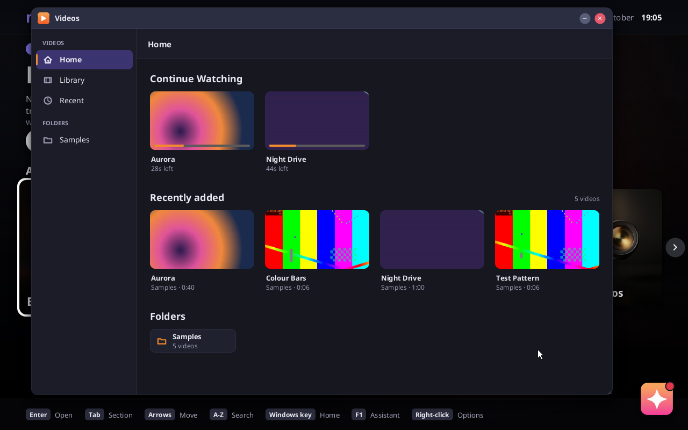
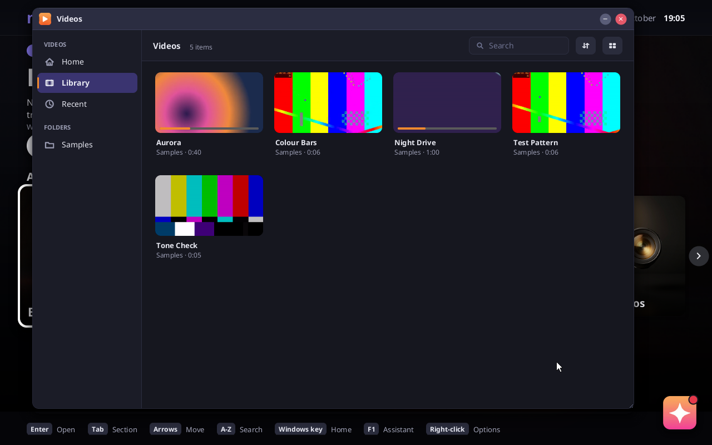
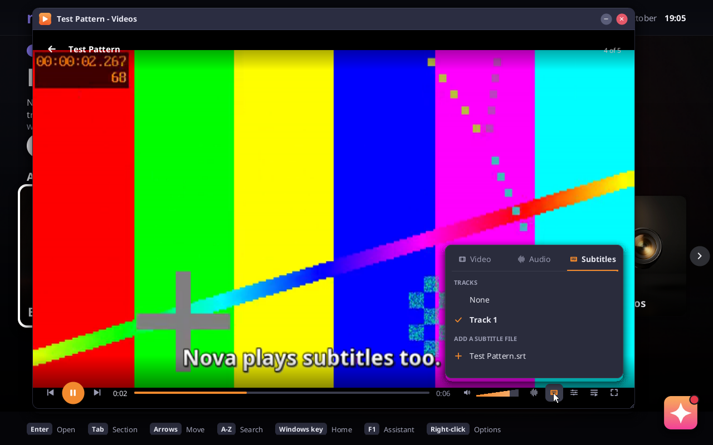
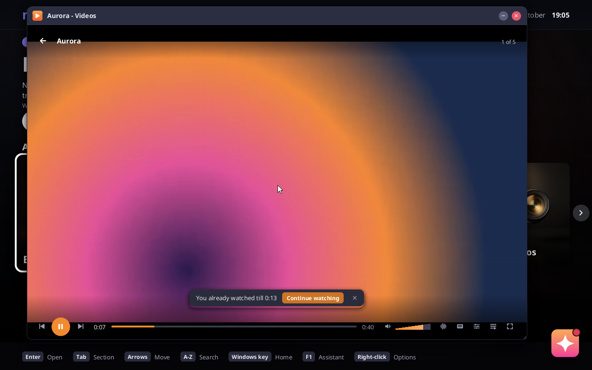
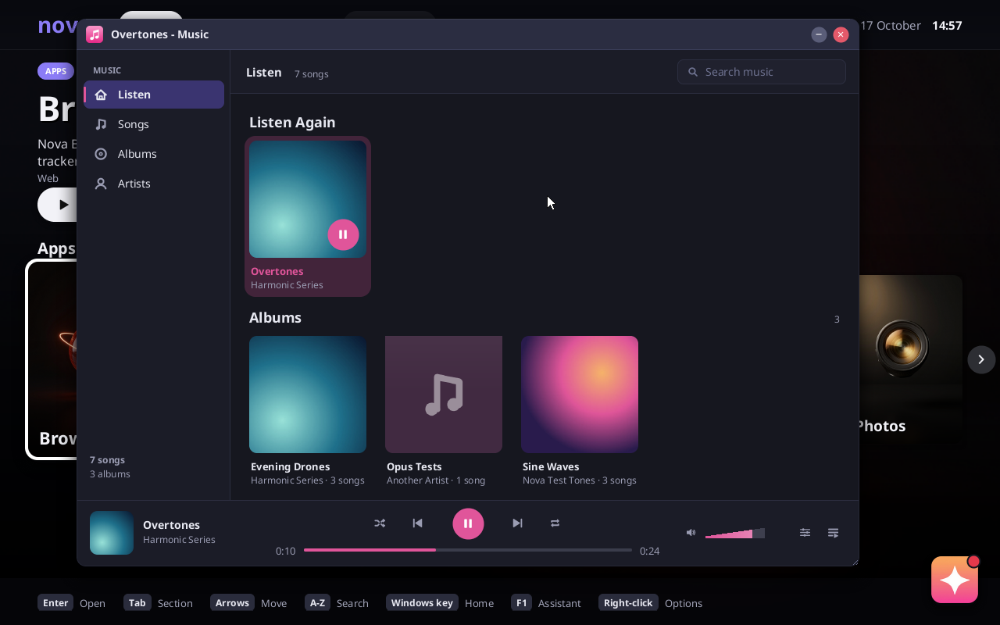
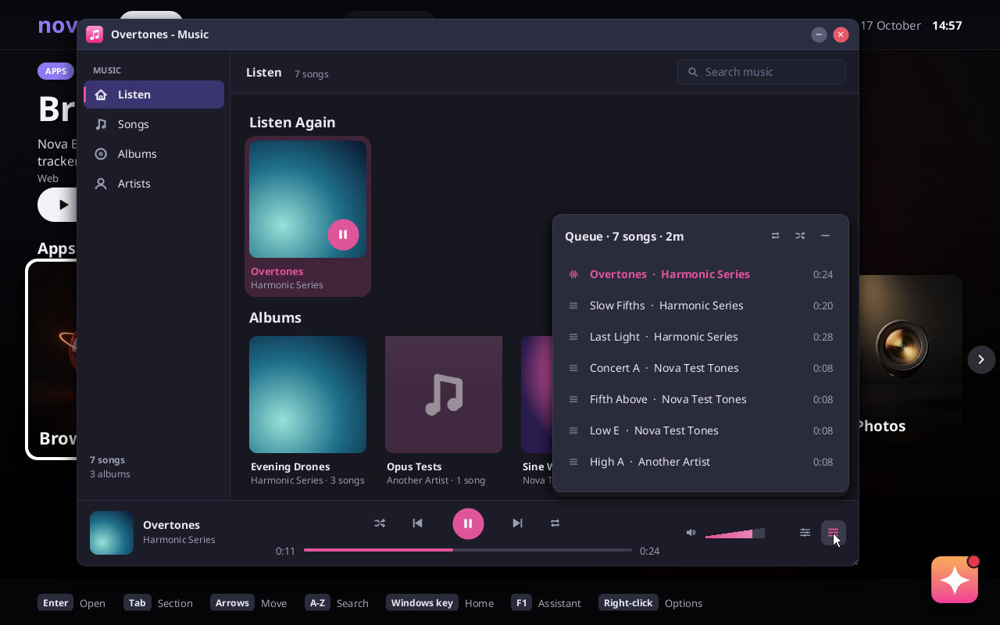
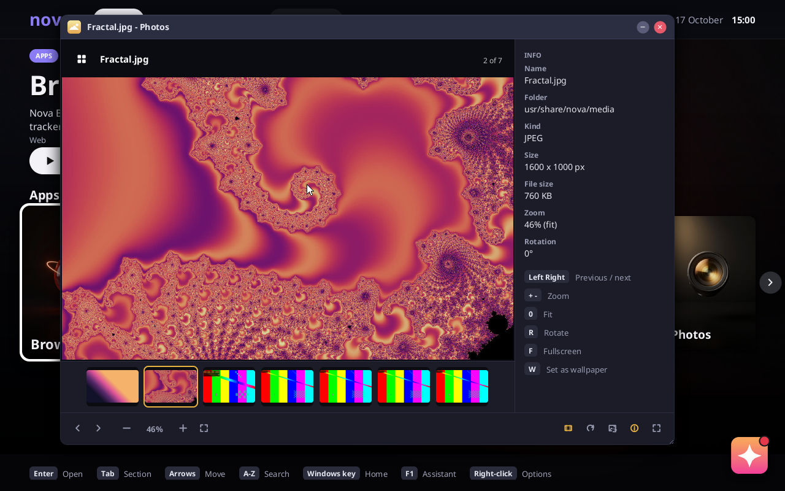
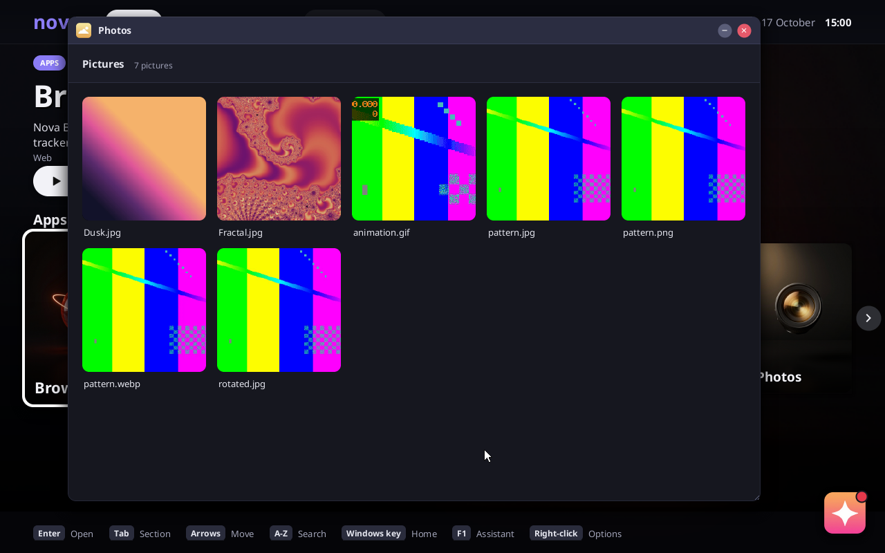

# Videos, Music and Photos

Nova's own media apps: a video player, a music player and an image viewer, drawn with
Nova's toolkit like Files and the Text Editor, with libVLC as the decoding engine behind
the two players.

| | |
|---|---|
|  |  |
| Videos: Home with Continue Watching | The library grid |
|  |  |
| The player: one bar, the subtitles popover, an .srt subtitle | "You already watched till 0:13" |
|  |  |
| Music: Listen Again, albums, the now-playing bar | The queue |
|  |  |
| Photos with the info panel and filmstrip | The picture grid |

## Design

The brief was VLC's engine with a layout that is not 25 years old, after Juxtopposed's
redesign study ("I Redesigned VLC After 25 Years"). What that redesign gets right, and
what these apps take from it:

- **A library first, a player second.** VLC opens on an empty black rectangle with a
  playlist hidden behind a menu. The redesign opens on Home: *Continue Watching* with
  thumbnails and progress, *Listen Again*, recently added, folders, and a sidebar
  (Home, Videos, Music, Recent) with a back/forward breadcrumb bar, item count, sort,
  list/grid and search. Videos and Music here are built that way, each with its own
  sidebar because Nova ships them as two apps (and a third for pictures), as the
  desktop convention is.
- **One slim control bar.** VLC's player stacks two rows of 14 buttons and a slider
  under the video. The redesign keeps one bar: previous, play, next, elapsed, seek bar,
  length, a tapered volume wedge, then audio, subtitles, settings, queue. The bar here is
  56 px, hides after 2.5 s while playing and comes back on movement, and the popovers
  (tracks with Video/Audio/Subtitles tabs, embedded and external tracks; settings with
  speed, subtitle and audio delay sliders; the queue with "N items · 47m", shuffle,
  repeat, the playing item in the accent) open above the buttons that own them instead
  of in dialogs.
- **Remembered state.** "You already watched till 12:34 — Continue watching" as a toast
  with one button; the first visit to the player shows a sheet of the keyboard shortcuts
  (Space, F, arrows, N/P, Q, L, V, B, M, Shift+S), after which it stays out of the way.
- **The accent means something.** The redesign's orange is used for the one primary
  action, the playing item and the filled part of the seek and volume bars, nothing
  else; the chrome is Nova's dark palette. Each app has a signature colour from the same
  family as its key art on Home: tangerine for Videos, magenta for Music, gold for
  Photos. Everything else (type scale, 32 px controls, 36 px sidebar rows, 8/10/12 px
  corners, hover and pressed fills, focus rings, toasts, empty states) is `ui.rs`, so
  the apps look like the rest of the desktop.

Not taken from the redesign: the network/discovery section, playlists as a first-class
object (the queue is enough for now), the customisable toolbar (the bar is small enough
not to need it), theme and accent pickers (Nova has one theme).

## Architecture

```
Videos / Music / Photos (kernel/src/media/*.rs, native apps on wm.rs + ui.rs)
   │ engine.rs: two pipes (fd 3 commands in, fd 4 events out, one line each)
   ▼
bin/novamedia (userland/media/novamedia.c, a libVLC program, one per player)
   ├─ video: libvlc_video_set_callbacks → RV32 frames into a memfd (two slots)
   │         ──► the kernel reads the memfd's pages directly (linux::shared_memory)
   └─ audio: libVLC's pulse module → Nova's PulseAudio server (pulse.rs) → HD Audio
```

- **The engine process.** `Engine::start` spawns `bin/novamedia` with the same pipe
  trick the browser uses for Chromium (`linux::kernel_pipe`). Commands are text lines
  (`open <path> [ms]`, `play`, `pause`, `seek <ms>`, `rate`, `volume`, `atrack`/`strack`,
  `sdelay`/`adelay`, `sub <file>`, `eq <preset>`, `probe`, `thumb <path> <percent>`,
  `decode <path>`); events come back the same way (`time`, `length`, `state`, `meta`,
  `track`, `frame`, `format`, `log`). Each app owns one engine, so music keeps playing
  while a video plays in another window.
- **Frames without copying through pipes.** The program creates a memfd of two frame
  slots, maps it, and lets libVLC render into them (`libvlc_video_set_format_callbacks`
  asks for RV32 at the source size, capped at 1920x1088). On every displayed frame it
  writes `frame <slot> <w> <h>`; the kernel finds the memfd through the program's
  descriptor table (`FdTable::get` + `linux::shared_memory`) and copies that slot's
  visible area into a `Canvas` straight from the shared pages (`engine.rs::copy_rows`).
  libVLC renders into the other slot meanwhile. The app then scales the frame into its
  window (box filter down, bilinear up: `video::draw_frame`), so resizing and fullscreen
  are the app's business and nothing about the engine changes. Fullscreen is a small
  addition to the window manager (`wm::set_fullscreen`): the client area covers the
  screen and the frame moves off it.
- **Audio** is libVLC's own pulse output talking to Nova's in-kernel PulseAudio server,
  as any Linux program would; volume, mute, the equalizer presets and the audio delay are
  libVLC's.
- **Pictures** are decoded in the kernel: PNG (`gfx.rs`), JPEG with the EXIF orientation
  applied (the pure-Rust `zune-jpeg` crate, built without SIMD), GIF including
  animations (`media/image.rs`, an LZW decoder of its own with local palettes,
  interlacing and disposal). WebP, BMP, TIFF and anything else libVLC/ffmpeg reads go
  through the engine's `decode` command, which renders the picture into the frame
  buffer like one frame of video. Files' thumbnails and the music covers use the same
  decoder.
- **The library** (`media/library.rs`) is the user's `Videos/`, `Music/` and `Pictures/`
  folders plus the samples in the image (`usr/share/nova/media/`, listed as the
  "Samples" folder). What the apps remember lives in small tab-separated files under
  `appdata/media/`: resume positions, play history, song tags, and decoded thumbnails
  as PNGs (bounded, NovaFS is a RAM disk in a live session). Thumbnails and tags are
  made in the background with the engine's `thumb` and `probe` commands while nothing
  plays; cover art embedded in songs is extracted by libVLC's taglib module into its
  cache (a tmpfs file the kernel reads with `vfs::read_file`).
- **Opening files.** `apps::launch` routes videos, songs and pictures to their apps by
  extension (`media::open_file`), so Files, Home and `nova.launch=<file>` open them.
  The Craft branch's desktop entries (`desktop.rs`: `usr/share/applications/*.desktop`,
  `MimeType=`, `desktop::handler_for`) open documents with Linux programs. When the two
  meet, `apps::launch` should ask `media::open_file` *before* `desktop::handler_for`, so
  the native apps stay the default for `image/*`, `audio/*` and `video/*` (desktop.rs
  already maps png/jpg/webp/gif/mp3/flac/ogg/wav/mp4/mkv/webm to those MIME types) while
  a Linux program that claims a type the apps do not read (`image/svg+xml`, PSD, Krita)
  still gets it. The native apps are not Linux programs, so they get no `.desktop` files
  of their own (`desktop::launch` runs `Exec` through `/bin/sh`); an "Open with" list
  would show the native app first and the matching desktop entries after it.
- **Rhai entries.** `system/apps/{video,music,photos}.rhai` are the entries Home and the
  Library list; like Files and the Text Editor they are routed to the native code.

- **A kernel fix the engine needed.** libVLC stops its audio output by cancelling a
  thread (`pthread_cancel`), and glibc implements that with `tgkill(SIGCANCEL)` to that
  thread. Nova used to make such a signal pending for the whole process and never woke a
  thread blocked in a futex wait, so the cancelled thread slept on and the engine hung on
  the second file it played. `tgkill` now reaches exactly its thread
  (`signal::send_thread`) and a pending signal ends a futex wait with `EINTR`, as on Linux.

## The image

Nothing of VLC is in the repository. `NOVA_MEDIA=1 scripts/build.sh` compiles the
engine against the host's libvlc (3.0.24 on the build host) and copies libvlc,
libvlccore, the pulse helper library and a trimmed plugin set into the image's system
pak with every shared library they need:

| Plugins | For |
|---|---|
| access: filesystem, attachment | files, embedded pictures |
| demux: mp4, mkv, avformat, avi, ogg, es, flacsys, wav, aiff, subtitle, image, h26x, mpgv, ps, ts, mjpeg, vobsub, rawaud | MP4/MOV, MKV/WebM, AVI, Ogg/Opus, MP3/AAC streams, FLAC, WAV, subtitles, pictures |
| codec: avcodec, dav1d, vpx, opus, flac, vorbis, mpg123, faad, a52, araw, adpcm, lpcm, theora, rawvideo, png, jpeg, subsdec, subsusf, webvtt, substx3g, spudec, cc | H.264/HEVC/MPEG via ffmpeg, AV1, VP8/9, the audio codecs, text and bitmap subtitles |
| packetizer (all), video_chroma (all), video_filter: blend, deinterlace, transform, scale, canvas | the pipeline between them |
| audio_output: pulse (amem, adummy as fallbacks); audio_filter: format, scaletempo, equalizer, gain, samplerate, ugly_resampler, channel mixers; audio_mixer | sound, speed without pitch change, the equalizer |
| meta_engine: taglib, folder; stream_filter: prefetch, cache, skiptags; text_renderer: freetype; video_output: vmem | tags and cover art, buffering, subtitle rendering, frames into memory |

Dropped: the Qt and other GUIs, Lua, every network access and streaming module,
services discovery, visualisations, VA-API/VDPAU, encoders and muxers, the skins. The
plugin cache (`plugins.dat`) is generated at build time with `vlc-cache-gen` inside
`bwrap` so the paths match the image.

Sample media for the apps and the test (generated by ffmpeg at build time,
`scripts/make-test-media.sh`, deterministic, about 5 MiB): a test pattern with a sine
tone as MP4/H.264+AAC, WebM/VP9+Opus and MKV/H.264+FLAC with an `.srt` file; two longer
clips of slowly moving gradients to watch and resume (Aurora, 40 s; Night Drive, 60 s);
tagged songs with embedded cover art on two albums (MP3, FLAC, Ogg Vorbis, Opus); and
pictures: a Mandelbrot zoom coloured with the magma palette, a dusk gradient, and the test
pattern as PNG, JPEG (one stored on its side with EXIF orientation 6), WebP and an
animated GIF.

Cost, measured on the build host: the system pak grows from 395 MB to 570 MB and the disk
image from 413 MiB to 585 MiB of written blocks, so NOVA_MEDIA=1 adds about 172 MiB.
Nearly all of it is shared libraries (the host's full ffmpeg build that libavcodec drags
in: x265, aom, SVT-AV1, rav1e, jxl, rsvg, ICU via libavformat's libxml2); the VLC plugins
are 4.6 MiB and the samples 5 MiB. Dropping the avformat demuxer (the native demuxers
cover MP4, MKV/WebM, AVI, Ogg, FLAC, WAV, MPEG) would save about 45 MiB; a leaner ffmpeg
build would save much more.

## Test

`NOVA_MEDIA=1 scripts/test.sh --case media` boots the shell with QEMU's HD Audio
recorded to a WAV file and runs the `media` shell command: the kernel decoders on the
JPEG (800x500), the rotated JPEG (800x500 after orientation), the GIF (20 frames); the
engine decoding the WebP; `probe` reading the MP3's tags; then `play` of the MKV sample
for three seconds, which must report the first frame (640x360) arriving through the
shared buffer and the Playing state, after which `scripts/check_audio.py` must find
the 440 Hz tone and nothing else in the recording. The case skips when the image was
built without NOVA_MEDIA=1 or the host has no libvlc.

## What works, what is left

Works: the three apps as described; playback of the sample formats with seeking,
speed, volume, tracks, external subtitles, queue, resume and history; thumbnails and
tags in the background; JPEG/GIF/PNG in the kernel and WebP through the engine; set as
wallpaper; Continue Watching cards resume where the video stopped, and opening a video
from the start and leaving at once keeps the earlier position; the `media` test.

Left for later:

- Hardware decoding (the engine runs on software codecs; fine for 720p in QEMU, real
  machines will want VA-API through the GPU work).
- Playlists as saved objects, network sources, chapters, a frame-step key, A-B loop.
- The music player reads tags one file at a time with the engine; a large library
  takes a while the first time (the results are cached).
- Album art for songs without embedded pictures (folder.jpg) and lyrics.
- A proper file picker for external subtitles (today: files next to the video). A
  subtitle file libVLC loaded by itself (same name as the video) is listed under Tracks
  and again under "Add a subtitle file".
- Wiring into desktop.rs's file associations once the Craft branch is merged (see
  Opening files above).
